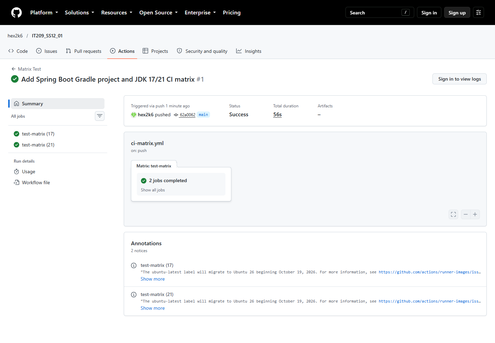

# Bài nộp — Session 12, Exercise 1

## Sản phẩm

- Workflow: [ci-matrix.yml](../../../.github/workflows/ci-matrix.yml)
- Ảnh chụp GitHub Actions: [actions-matrix.png](actions-matrix.png)
- Lượt chạy đã xác minh: [Matrix Test #1](https://github.com/hex2k6/IT209_SS12_01/actions/runs/38436008159)

## Kết quả

- `test-matrix (17)`: thành công.
- `test-matrix (21)`: thành công.
- Cả hai job chạy song song và thực thi `./gradlew test`.
- Kiểm thử khởi động Spring context thành công trên cả hai JDK.
- `actions/setup-java@v5` sử dụng Temurin với `cache: gradle`.

Workflow được đặt tại `.github/workflows/ci-matrix.yml` ở gốc repository để GitHub Actions nhận diện và tự chạy khi push vào `main`.
Lần chạy đầu tải dependency và lưu cache; những lần sau có thể khôi phục cache để giảm thời gian tải.
